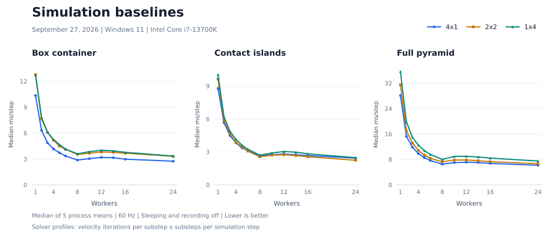

# Benchmarks

Published Entasis performance baselines, measured on Windows 11 with an Intel Core i7-13700K and 24 logical processors. Worker counts include the caller and CPU placement is unpinned. Compiler identity and measurement date belong to each dated result set. The timing tables describe that machine and setup, without a cross-device comparison

## Simulation baselines

September 27, 2026, using the contact-optimized engine and Odin `dev-2026-09-nightly:a2fb372`, Release `-o:speed`, `x86-64-v3`, with bounds checks and assertions disabled

The current baseline covers Box Container, Contact Islands and Full Pyramid at 4x1, 2x2 and 1x4. All nine profiles explicitly disable sleeping and recording. Each table entry is the median of five process mean step times, in milliseconds per step. Lower is better. These are not individual-frame latency percentiles

Each profile retains five raw samples at workers 1, 2, 3, 4, 5, 6, 8, 10, 12, 14, 16 and 24

### Solver profiles

The notation is **velocity iterations per substep x substeps per simulation step**. Every simulation step advances 1/60 second

| Profile | Velocity iterations per substep | Substeps per 60 Hz step | Run options                            |
| ------- | ------------------------------: | ----------------------: | -------------------------------------- |
| 4x1     |                               4 |                       1 | `-VelocityIterations 4 -Substeps 1` |
| 2x2     |                               2 |                       2 | `-VelocityIterations 2 -Substeps 2` |
| 1x4     |                               1 |                       4 | `-VelocityIterations 1 -Substeps 4` |

All profiles perform four velocity iterations across the full step, but their substep work and resulting trajectories differ. Equal iteration totals do not establish equal performance or accuracy. The dated tables below preserve their original three-profile measurements

Bold values mark the lowest observed median among the three profiles at the same worker count, without implying a statistically resolved ordering

### Box container

| Workers |   4x1 ms/step | 2x2 ms/step | 1x4 ms/step |
| ------: | ------------: | ----------: | ----------: |
|       1 | **10.347018** |   12.761452 |   12.748119 |
|       2 |  **6.313046** |    7.624662 |    7.809493 |
|       3 |  **4.867344** |    6.078345 |    6.102437 |
|       4 |  **4.153797** |    5.169785 |    5.251157 |
|       5 |  **3.715510** |    4.493097 |    4.653638 |
|       6 |  **3.349080** |    4.107351 |    4.150579 |
|       8 |  **2.872174** |    3.545752 |    3.586410 |
|      10 |  **3.034352** |    3.664513 |    3.850454 |
|      12 |  **3.182395** |    3.812391 |    4.004593 |
|      14 |  **3.148892** |    3.771288 |    3.943334 |
|      16 |  **2.972920** |    3.672388 |    3.768768 |
|      24 |  **2.738088** |    3.304977 |    3.331770 |

Reports and raw samples: [4x1](results/container/box-4x1-awake/2026-09-27/README.md), [2x2](results/container/box-2x2-awake/2026-09-27/README.md), [1x4](results/container/box-1x4-awake/2026-09-27/README.md)

### Contact islands

| Workers |  4x1 ms/step |  2x2 ms/step | 1x4 ms/step |
| ------: | -----------: | -----------: | ----------: |
|       1 | **8.780762** |     9.639913 |   10.036811 |
|       2 | **5.662878** |     5.900524 |    6.216592 |
|       3 | **4.481518** |     4.665508 |    4.870748 |
|       4 | **3.831368** |     3.883836 |    4.154191 |
|       5 | **3.365430** |     3.476117 |    3.615868 |
|       6 |     3.094042 | **3.071698** |    3.238050 |
|       8 |     2.676649 | **2.547864** |    2.698150 |
|      10 |     2.740410 | **2.701932** |    2.897382 |
|      12 |     2.803748 | **2.743643** |    3.034015 |
|      14 |     2.740498 | **2.670759** |    2.972960 |
|      16 |     2.663297 | **2.558937** |    2.824561 |
|      24 |     2.431708 | **2.235791** |    2.476813 |

Reports and raw samples: [4x1](results/contact_islands/box-4x1-awake/2026-09-27/README.md), [2x2](results/contact_islands/box-2x2-awake/2026-09-27/README.md), [1x4](results/contact_islands/box-1x4-awake/2026-09-27/README.md)

### Full pyramid

| Workers |   4x1 ms/step | 2x2 ms/step | 1x4 ms/step |
| ------: | ------------: | ----------: | ----------: |
|       1 | **28.108629** |   31.440918 |   35.620657 |
|       2 | **15.243167** |   16.968097 |   19.827994 |
|       3 | **11.852377** |   13.126816 |   14.938140 |
|       4 |  **9.819090** |   10.815479 |   12.501634 |
|       5 |  **8.564632** |    9.373924 |   10.767997 |
|       6 |  **7.640974** |    8.339649 |    9.555969 |
|       8 |  **6.509744** |    7.240036 |    8.005019 |
|      10 |  **6.991403** |    7.804723 |    8.933427 |
|      12 |  **7.109722** |    7.805863 |    8.981039 |
|      14 |  **7.017965** |    7.585698 |    8.759080 |
|      16 |  **6.751774** |    7.304892 |    8.417103 |
|      24 |  **6.155543** |    6.624692 |    7.485239 |

Reports and raw samples: [4x1](results/pyramid/box-4x1-awake/2026-09-27/README.md), [2x2](results/pyramid/box-2x2-awake/2026-09-27/README.md), [1x4](results/pyramid/box-1x4-awake/2026-09-27/README.md)

### Physical validation

These timings do not establish penetration, resting-jitter or full-trajectory accuracy. Pyramid post-impact dispersal beyond the finite floor does not rank contact accuracy

## Ragdoll Stair-Tumble

September 13, 2026, using Odin `dev-2026-09:c59786ce8` on the same Windows 11/i7-13700K host with DDR5-4800, using the 4x1 solver. Values are medians of five process mean step times, in milliseconds per step. Lower is better

| Workers | Median ms/step |
| ------: | -------------: |
|       1 |       6.662286 |
|       2 |       4.326049 |
|       3 |       3.518923 |
|       4 |       2.993225 |
|       5 |       2.638809 |
|       6 |       2.461467 |
|       8 |       2.132619 |
|      10 |       2.243594 |
|      12 |       2.295174 |
|      14 |       2.287193 |
|      16 |       2.259717 |
|      24 |       2.270396 |

[Report and raw samples](results/ragdoll_stair_tumble/ap5-20260913/README.md)

## Query results

September 10, 2026, using Odin `dev-2026-09:c59786ce8`. Values are medians of five process throughput measurements. Higher is better. Ray batches are in millions of rays per second, and mixed queries are in millions of queries per second

| Workers | Closest-ray batches (M rays/s) | Mixed spatial queries (M queries/s) |
| ------: | -----------------------------: | ----------------------------------: |
|       1 |                      10.235456 |                           11.839490 |
|       2 |                      20.424895 |                           23.492984 |
|       3 |                      30.232598 |                           34.454779 |
|       4 |                      39.885226 |                           46.067898 |
|       5 |                      49.702827 |                           55.747730 |
|       6 |                      59.085103 |                           65.585554 |
|       8 |                      76.117983 |                           84.144628 |
|      10 |                      64.728438 |                           72.491346 |
|      12 |                      72.432800 |                           83.453506 |
|      14 |                      84.365119 |                           92.670333 |
|      16 |                      96.633296 |                          106.287207 |
|      24 |                     136.785807 |                          157.396040 |

Reports and raw samples: [Closest-ray batches](results/spatial_query_batch/cooperative-wait-20260910-d2/README.md), [Mixed spatial queries](results/spatial_query_trace/2026-09-10/README.md)

See the [closest-ray workload](benchmarks/spatial_query_batch/README.md) for its scene, batch sizes and timing details

## Workloads and timing

The simulation fixtures use 60 Hz, gravity `(0, -10, 0)` and zero damping. The September 27 baselines use the three solver profiles above. The Ragdoll Stair-Tumble baseline uses 4x1

- **Ragdoll Stair-Tumble:** 512 fifteen-body ragdolls, 7,168 ball sockets, 64 stairs and four catch-basin statics, with linked-body collisions enabled. A disposable world runs 30 warmup steps, then a fresh world runs 600 measured steps
- **Box Container:** 10,000 dynamic boxes in a 25 x 16 x 25 pile, five static colliders and sleeping disabled. A disposable world runs 30 warmup steps, then a fresh world in the same pool runs 300 measured steps
- **Contact Islands:** 10,000 dynamic boxes in 50 stacks of 5 x 8 x 5, 50 static floors and sleeping disabled, with components common. The same world runs 30 warmup steps and then 300 measured steps
- **Full Pyramid:** 16,206 cubes, four sphere projectiles and one floor, with sleeping disabled in the current baseline. The fixture default uses sleeping enabled. No warmup and 600 measured steps, with projectile launch inside step index 120
- **Closest-ray batches:** 50,000 prepared closest rays per batch. Both caller and mailbox execution submit at most 256 inputs per `entasis.query_batch` call under the same worker partition. Ten warmup batches and 100 measured batches
- **Mixed spatial queries:** 10,000 static boxes and 100,000 queries per batch: 50,000 closest rays, 25,000 sphere casts with radius 0.5 and 25,000 AABB overlap-presence queries. Ten warmup batches and 100 measured batches

Simulation timing excludes setup, warmup, validation and teardown. The retained Box Container baseline times the whole step loop. Current Verify On and recording On sum native step intervals, with assessment and capture after each interval. Verify Off with recording Off retains whole-loop timing. Contact Islands, Ragdolls and Pyramid sum per-step times, including Pyramid's launch work. Divide each process total by its measured step count before taking the median

Contact Islands with recording Off also retains each measured native step as `STEP_TIMING step=<one-based-index> elapsed_ns=<integer>` in process stdout. Its CSV appends `step_p50_ms`, `step_p95_ms`, `step_p99_ms` and `step_max_ms`, computed after measurement using nearest rank over that process's steps. These are individual-step observations within one process, separate from the process-mean tables above. Recording On leaves the four fields `unavailable` and preserves its existing timing and capture path

`shape_mixed_bounds` measures production bounds prediction for 9,216 bodies across nine shape types, first round-robin and then grouped into 1,024 bodies per type. Both layouts contain the same authored shapes, poses and velocities. Each layout runs 30 warmup calls and 3,000 timed `world_stage_predict_bounds` calls on the same world and dispatcher, with unchanged body inputs. New rows record warmup-cycle=same-owner-predict. Earlier rows without that token warmed a disposable world and measured a fresh world, and belong to a separate preparation cohort. The independent bounds oracle uses the unchanged 2e-4 tolerance outside timing. `physics_elapsed_ms` retains the round-robin result and `bounds_clustered_ms` reports the clustered result. Counts describe one layout. Construction uses one velocity iteration and four substeps, but this stage measurement executes no solver and is not full-step timing

Both query packages accept `-RayPattern axial|oblique` on Windows, default axial. Axial preserves the published inputs. Oblique rays use one unit dominant component and two components of magnitude 1/64, projecting hit origins toward target centers and directing misses outward. Sphere casts and overlaps stay unchanged. CSVs record `ray_pattern`, and reports reject mixed patterns. Oblique results use a separate `oblique` directory below the package, before the optional precision directory

Closest-ray batch timing includes dispatch/session entry and exit, query work, result writes, and one common caller-side status validation, hit projection/counting and checksum pass after join. Complete input construction, context reservation, setup, allocation, warmup, scalar reference checks and teardown are outside timing. Both execution modes use the same complete input/result workspace. Historical closest-ray timings included input construction and consumption inside worker chunks and are not comparable to this timer. Mixed spatial query timing retains its existing boundary. The ray report records elapsed milliseconds for all measured frames. Throughput is `ray_query_count * measured_batches / (ray_elapsed_ms * 1000)` in millions of rays per second. Mixed-query CSVs record throughput in `queries_per_second`

## Physical qualification

Current Container, Contact Islands and Pyramid runs default to verification On. `-Verify Off` on Windows or `--verify off` on Linux skips assessment and records Unassessed with reason `verification_off`. Container qualification requires equal box dimensions. Unequal boxes remain accepted benchmark inputs with Unassessed outcomes. Other valid custom geometry or insufficient assessment windows also remain accepted inputs with Unassessed outcomes. Existing saved results without the new evidence are Unassessed

Assessment reads construction and every completed warmup/measured state outside native timers. Container recreates its measured world after warmup, retains applicable warmup safety failures and checks finite state plus upward escape after full-box entry below the rim. Contact Islands checks shape over exactly the final `Hz+1` measured states (`N-Hz..N`, requiring `N>Hz`), with finite-state and assigned support-plane safety throughout. Pyramid checks its unforced trajectory and excludes the ending state of the first possible projectile-impact interval, even before scheduled launch. A Pyramid Pass requires at least one assessed completed step; impact during construction or step 1 leaves an intact fixture Unassessed. Earlier breaches remain Fail. Wall checks its complete unforced trajectory

Shape limits are whole-box authored-slot excess and assigned-neighbor compression: 10% of the minimum full box edge for Islands, and 0.10 m for Pyramid/Wall. Projection normalizes finite nonzero rotations. Islands, Pyramid and Wall also check their assigned support planes: a bottom-layer center must remain at or above the actual floor top, and an upper center at or above its lowest assigned support center plus the original vertical half extent. These fixed-axis structural measures are not contact-manifold penetration or a general oriented-box intersection test. Existing height, drift, speed and rotated-floor measurements remain diagnostics, with no additional settling-speed criterion

CSV fields record verification mode, criterion, outcome, coverage, counts, limits, first breach, worst observations and projectile cutoff. Zero-based body identities refer to the authored fixture, and step numbers count completed work units. A physical breach remains Fail after recovery or impact. Completed timing rows retain `case_status=ok,metric_status=ok` before physical Fail returns status 2. Run preserves the pending CSV/logs and finalized recording, stops later repeats/workers and publishes no successful report

Verification On changes Container timing to `native_step_sum`, while recording Off plus verification Off retains `whole_loop`. Islands and Pyramid retain native step intervals, including Pyramid launch work. Verification mode is included in new canonical parameters. Assessment and recording can affect caches and wall time outside those intervals, so compare only compatible routes

## Configurable workloads

On Windows, `container`, `contact_islands` and `pyramid` require `-Shape box|sphere|capsule|cylinder|hull` and `-Variant`. Static floors and walls use `-StaticShape box|hull`, defaulting to box. Hulls are cooked eight-corner cuboids. Pyramid projectiles remain spheres

Common options are `-ShapeSize 'X,Y,Z'` (full dimensions), `-Density`, `-LayoutScale`, `-Steps`, `-TimestepHz`, `-WarmupSteps`, `-VelocityIterations`, `-Substeps` and `-Sleep enabled|disabled`

Shape dimensions must satisfy these rules:

- Sphere: X=Y=Z
- Cylinder: X=Z
- Capsule: X=Z and Y>X. Radius is X/2 and cylindrical length is Y-X

Default sizes match each fixture's cube. Capsules use half its X/Z size. Layout scale multiplies default lengths and positions. Explicit dimensions and positions are absolute overrides. Shapes do not auto-pack or resize floors

Container and islands accept `-Grid 'X,Y,Z'`, `-Spacing 'X,Y,Z'` and `-SpawnHeight Y`

- Container also accepts `-ContainerSize 'X,Y,Z'`: floor width, wall height and floor depth, defaulting to 29,24.5,29
- Islands also accepts `-IslandGrid 'X,Z'`, `-IslandSpacing 'X,Z'` and `-FloorSize 'X,Y,Z'`. Initially overlapping island floors are rejected

Pyramid accepts `-FloorSize`, `-Rows`, `-ProjectileCount`, `-LaunchStep`, `-ProjectileRadius`, `-ProjectileDensity`, `-ProjectileCenter 'X,Y,Z'`, `-ProjectileSpacing 'X,Y,Z'` and `-ProjectileVelocity 'X,Y,Z'`

Zero projectiles disables launch. Otherwise the zero-based launch index must precede the measured step count. Pyramid warmup must be zero. A small Sphere Pyramid configuration previously exhausted the parallel broad-phase job buffer at two workers and remains unsupported by the recorded checks

Input limits:

- Dynamic bodies, measured/warmup steps, and positive timing/solver integers: at most 1,000,000
- Scalar values: decimal syntax, at most 64 characters, representable as finite f32
- Dimensions, density and scale: positive
- Derived placement, mass, inertia and capacity arithmetic: representable

Invalid, duplicate, unknown and inapplicable options are rejected before physics allocation

Reports record effective settings in `benchmark_parameters` and reject mismatched samples

Variant names use `[A-Za-z0-9][A-Za-z0-9._-]*`. Reports identify each configurable workload by its variant and effective settings

## Extension workloads

[Extension benchmark definitions](benchmarks/EXTENSIONS.md) cover custom callbacks, query contexts and distance/separation, allocation/lifecycle, and optional trigger/restitution/body-control costs. The Windows runner accepts `-Components Common` or `-Components All` for `custom_extensions`, `query_extensions` and `contact_islands`. Common runs the base workloads, while All adds separately reported feature groups. These are native Odin workloads. The dated published results above remain their original measurements

Selected `query_extensions` cells, supported operations and independent geometry checks are documented under [extension query workloads](benchmarks/EXTENSIONS.md#queries)

### Selected Windows query measurements

The query cases use the following workload selectors and repetition counts

| Run option | Package | Meaning and default |
| --- | --- | --- |
| `-QueryGroup ROUTE.OPERATION` | query_extensions | One case-sensitive group, omitted runs the complete workload |
| `-QueryRepetitions N` | query_extensions with a group | Measured chunks of 8,192 API calls, default 1 |
| `-QueryWarmupRepetitions W` | query_extensions with a group | Warmup chunks of 128 calls, default 1 |
| `-QueryFamily all\|ray\|sphere-cast\|aabb-presence` | spatial_query_trace | Existing scalar execution families, default all |
| `-WarmupBatches W` | Both spatial packages | Warmup batches, default 10 |
| `-MeasuredBatches N` | Both spatial packages | Measured batches, default 100 |

Counts are decimal integers in 1..1,000,000. Options may occur once. Repetition controls require an explicit group. Batch rejects an explicit family selector, including all. Oblique requires a ray-containing workload

Extension routes are `convex`, `compound`, `mesh` and `native_custom`. Each supports the eight Common operations below. Components All adds `closest_point`, `shape_distance`, `depenetration` and `overlap_any`, for 48 groups in total

| Domain | Existing operation or lane | Measured path |
| --- | --- | --- |
| Rays | ray_closest, ray_filtered, ray_all; trace ray; spatial_query_batch | Public shape queries, scalar traversal or public batch execution |
| Shape casts and sweeps | sweep_closest, sweep_all; trace sphere-cast | Existing shape API or scalar sphere sweep including dispatcher costs |
| Geometric overlap | geometric_overlap, overlap_any | Shape overlap, with overlap_any requiring All |
| AABB presence | trace aabb-presence | Volume-any query against an empty active tree and populated static tree |
| Shape collision | direct_collision, collision_batch | Direct query or two ordered pair tests per batch API call |
| Closest point | closest_point | Existing All-only query |
| Shape distance | shape_distance | Existing All-only query |
| Depenetration | depenetration | Existing All-only bounded iterative query |

The extension fixtures use a sphere, a compound with two spheres, a two-triangle mesh and a native custom sphere, with 17 repeated input positions. They cover API and dispatch paths, rather than arbitrary hulls, large meshes, changing worlds or large-world distributions

Focused extensions allocate the original sample buffer, restart the original input sequence for each chunk and validate every chunk outside timing. Reported time sums measured chunks. Other group cells and complete Common/All totals are excluded. Mean ns/API call divides the accumulated time by 8,192*N. Collision batch reports API calls and pair tests separately. The loop is serial, so worker counts configure world resources and timing ratios do not establish parallel query scaling. Repetitions within one process are one observation, not independent samples

Spatial reports normalize totals to milliseconds per measured batch. Trace executes 100,000 queries per batch for all, 50,000 for ray or 25,000 for either other family. Skipped counts, hits, checksums, durations and rates are excluded. Hits and checksums retain their per-batch meanings. Scalar reference validation and CSV output remain outside timing; the prepared closest-ray batch timer includes its common post-join validation/checksum pass. Neither spatial aggregates nor repeated extension chunks supply p95/p99 latency distributions

Current CSVs include the compiled precision, and spatial CSVs also record `ray_pattern`. Focused extension rows add selection and repetition metadata, while single-family trace rows add `query_family`. Readers retain an unspecified profile for historical rows without precision, interpret a missing pattern as axial and treat absent selection metadata as the complete workload. Historical precision must be established from the retained source. Reports and saved datasets reject incompatible selections, counts, components, precision and patterns

## Optional playback recording

Recording Off and On identify distinct measurement conditions. Container, baseline contact islands, pyramid, ragdoll stair tumble, noncontact constraint mix and noncontact fallback smoke can record the actual measured world

On accepts `-Compression lz4|lz4hc` and `-MemoryMiB 64..16384`, defaulting to LZ4 and 512 MiB. Each worker/repeat owns a fresh finalized recording. The CSV's relative `recording_path` and `recording_component` associate it with the exact sample. Missing legacy fields mean unavailable playback

`recording_mode` and `timing_method` keep capture conditions distinct. Off preserves existing timing. On captures outside complete native-step intervals. Container and the two noncontact producers switch from `whole_loop` to `native_step_sum`. Capture still affects cache, memory and total runtime. Reporter ingestion rejects incompatible conditions

Contact-islands recordings cover baseline `physics_elapsed_ms`, not the extra component measurements. A median has no recording

## Large-world precision qualification

The `large_world_precision` cases compare `baseline`, `origin` and `mixed64`, with sampling modes `batch`, `instrumented`, `engine-only` and `memory`. Other benchmark cases record their compiled Float32 or Mixed64 profile outside timing

Simulation cases keep 60 Hz, one velocity iteration per substep and four substeps, disabled sleeping, 30 disposable warmups and 512 recreated measured frames. Precision queries use worker 1, 128 warmup probes per family and eight passes over fixed 1,024-probe inputs. Baseline compact 10 km is an unranked boundary observation. Baseline 1,000 km/1 Gm are expected accuracy failures. Origin does not support distributed or spanning cases

Batch measures maintenance, real engine work and high application-position export in one interval. Instrumented mode also retains frame/pass and maintenance events. Engine-only times actual simulation steps separately. Memory runs track world/pool/worker allocations and application buffers in separate processes, require zero owned bytes after teardown, and produce no timing/scaling chart

Viewer and recording coordinates remain float presentation data

## Native query dispatch experiment

Spatial batch cases compare `caller` and `mailbox` query execution over the same prepared 50,000-ray workspace and fixed worker slices. Both call `query_batch` in submissions of at most 256 inputs. Caller uses ordinary dispatch, while mailbox wraps that dispatch in one resident session. W1 uses the direct path

CSVs identify the query execution mode and prepared/post-join timer. Every warmup and measured frame's checksum is compared with an untimed scalar reference after sampling elapsed time. That reference calls the same engine's scalar query route and is not an independent geometry algorithm

## Solver workloads

`solver_joint_angular` contains tilted shapeless hinge, weld and mixed chains with conserving momentum or gyroscopic integration. `solver_fixed_work --case conserving` measures reset-inclusive passes of eight-body bundles and four integration substeps. Fixed passes are reported separately from world-step means

Paired domain comparisons use five baseline/candidate pairs per cell, with arm order alternating by repetition. Headline costs are arithmetic means of the five process means in each arm. Gain % is calculated from those same full-precision means. Paired median gains and bootstrap intervals are separate supporting statistics

## Domain performance benchmarks

Each domain benchmark measures the production region listed below. Paired results use matching harness, fixed/restored/prescribed inputs, reset/history contracts, settings, work counts and CPU placement. Evolving-scene timings include trajectory-dependent changes in work and measure a different region

| Domain | Existing owner | Measurement |
| --- | --- | --- |
| Bounds | shape_mixed_bounds | Production bounds prediction, round-robin/grouped shapes, default 9216 or explicit --body-count 10000 |
| Trees and collision | simulation_stage_work | Separate tree update, pair traversal, narrow phase and combined collision stages on prescribed 10,000-body input |
| Convex contact graph | solver_contact_work | Same frozen graph and independently restored entry for native 1x4 solver calls |
| Cached/nonconvex contacts and joints | solver_fixed_work finite cases | Native registered solver graphs, independently restored between measured calls |
| Continuation and final integration | solver_fixed_work finite cases | Actual production integration entries, with reset-inclusive legacy cases explicitly distinguished |
| Queries and shape-pair collision | spatial_query_batch, spatial_query_trace, query_extensions | Declared query/pair API work, with their original counts and dispatch |
| Lifecycle and awakening | world_lifecycle, awakening_duplicate_sets | Lifecycle component timings or the existing awakening-specific full step |

The cached-convex fixed-work case has 2x2 and 4x1 solver budgets. Native convex, nonconvex and joint cases use a fixed 1x4 budget

Domain setup uses 10,000 bodies where that is the declared physical population. Pair/query/lifecycle controls keep their natural counts. Report static/dynamic/kinematic populations and actual processed rows/lanes separately. Use each timer's native unit, such as ms/measured frame, ms/stage, ms/solve, ms/pass, ms/query batch or declared query throughput. For elapsed costs, divide each process's measured time by the completed calls, passes, frames or queries that define that unit, then take the arithmetic mean of the five process means. Throughput uses the declared work count divided by elapsed time with its original unit conversion. A solver cost in ms/solve is divided by measured solve calls, while ms/1000 logical point updates uses its separate logical-point-update count. Do not sum overlapping timers, divide time by a terminal scene contact count or relabel a partial-domain timer as full physics/render/application ms/frame

Domain costs are arithmetic means of five process means per arm. Replay aggregates first average each input's five process means, then equally average the same inputs in both arms. Solver comparisons use `Threads | Baseline ms/solve | Candidate ms/solve | Gain %`. Threads includes the caller, and other domains use their declared native unit in both cost columns

For elapsed costs, Gain % is `100*(baseline_mean-candidate_mean)/baseline_mean`, using the same full-precision arithmetic means as the two cost columns before display rounding. Positive means faster and negative means slower. Published historical tables retain their original methods and labels

Paired median gains and bootstrap intervals describe supporting paired statistics, not the headline average-cost gain. Unpaired costs use each process's recorded measured count before averaging. Historical rows without count metadata remain labelled as process totals

Every measured domain call has same-process untimed observation of work, allocation and physical outcomes

Native fixed-work warmups use the same per-case reset, solve and observation cycle as measured iterations. Only measured passes contribute to reported time, coverage, quality summaries and work units; capacity snapshots are taken after warmup observation. The solver timer still surrounds only the production execution entry. New rows record warmup-cycle=restore-solve-observe in benchmark_parameters, separating this preparation contract from historical rows. The separate legacy conserving loop is unchanged

Stateful stage controls retain tree/cache history through 30 warmup and 300 prescribed measured frames, with driver writes/observation outside timing. Pool columns describe capacity growth across the measured-frame observation window, including untimed prerequisites and observation. New capacity-window=measured-frame rows snapshot before the first measured frame's prerequisites. Historical rows omitted those first prerequisites from their starting capacity. Pool growth cannot be attributed solely to the timed stage. Stage controls do not run a solver to generate inputs. Solver controls instead restore physical buffers and callback context before every independent call. Joint controls report hinge/weld anchor error and joint angle error separately from quaternion normalization. Historical absent angular metrics remain unassessed. The evolving solver_joint_angular timing route observes only its terminal state and records observation=terminal-only, so its late/max fields do not establish trajectory maxima. These reset/history contracts are distinct

## Controlled contact solver work

`solver_contact_work` measures contact-solver cost with identical captured entry state and contact graph for every compared implementation. Evolving-scene timings include trajectory-dependent changes in contact work and measure total simulation cost

Contact replay inputs come from Common Box Islands with in-process physical assessment. Each capture world runs thirty same-world warmups and supplies inputs immediately before measured steps 150 and 300

Each replay producer restores dynamics, contact geometry and carried impulses before ten warmups and one hundred measured calls. Both phases execute reset, solve and untimed observation in the same order. Only measured calls contribute to timing, coverage, quality summaries and logical point updates, with capacity snapshots after the last warmup observation. New rows record warmup-cycle=reset-solve-observe, separating the corrected preparation from historical rows. The native timer covers integrator preparation and `solver_solve`, including scheduling, gather/scatter, friction, fallback and continuation substep integration. Loading, reset, observation and output are outside the timer. Final pose and unconstrained integration are excluded. Poses and contact depths can evolve within the four substeps, so this fixes the entry state and graph rather than geometry throughout the solve

The report gives ms/solve, call latency percentiles and ms per 1000 logical normal contact-point updates. With P live contact points, R calls, S substeps and I velocity sweeps, the denominator is `R*S*I*P`. Valid zero-impulse contacts count and padded SIMD lanes do not. Final scene constraint counts cannot replace this denominator

Every measured call receives untimed f64 endpoint observation in the same process. Reports retain finite/impulse/friction feasibility, observation coverage and max/RMS/p95 normal residual in m/s. Residuals describe each version's final compliant contact equations, whose geometry can differ after four substeps. They do not establish equal physical accuracy or replace evolving scene quality. Hard Pass and residual magnitude remain distinct
